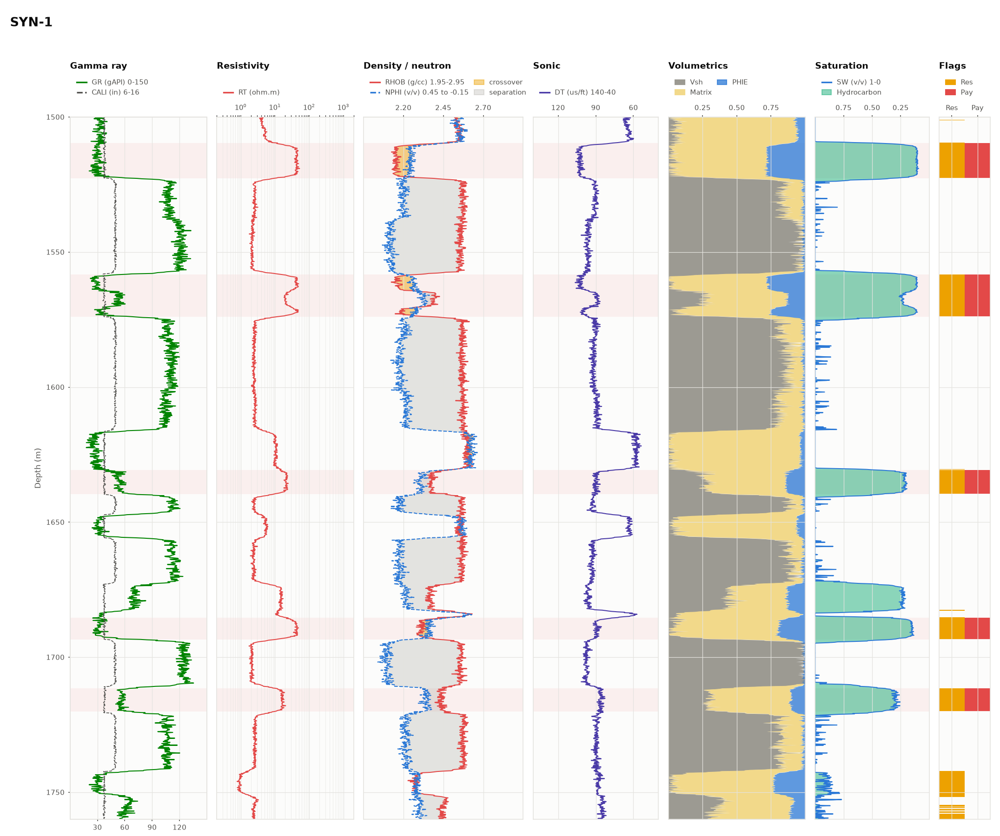
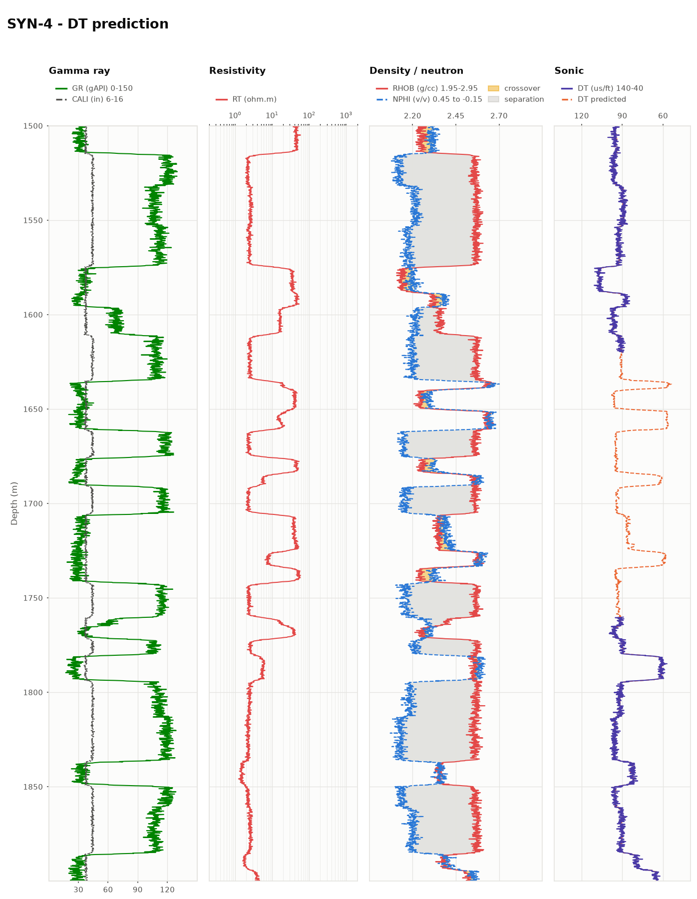

# wellog

A well log interpreter in Python. It reads LAS files, computes shale volume,
porosity and water saturation, flags net reservoir and pay, draws a
multi-track log display, and can train a model to predict missing logs such
as sonic.



## Features

- **LAS parsing** with [lasio](https://github.com/kinverarity1/lasio). Vendor
  mnemonics are mapped to canonical names (`ILD`/`AT90`/`LLD` -> `RT`,
  `RHOZ` -> `RHOB`, `TNPH` -> `NPHI`, `DTCO` -> `DT`, ...) and null values
  become NaN.
- **Shale volume** from the gamma ray index: linear, Larionov (Tertiary and
  older rocks), Clavier and Steiber. GR clean/shale endpoints are picked from
  percentiles if you don't supply them.
- **Porosity**: density, sonic (Wyllie or Raymer-Hunt-Gardner) and
  neutron-density with gas correction, all shale-corrected to effective
  porosity.
- **Water saturation**: Archie for clean rock, Simandoux for shaly sand
  (closed form for n = 2, bisection otherwise). Rw is estimated from the Rwa
  curve and Rsh from the shales when not given.
- **Pay flagging** with Vsh / porosity / Sw cutoffs and a minimum bed
  thickness, plus a per-zone table: gross, net, net-to-gross, averages and
  hydrocarbon pore thickness.
- **Log display** with tracks for GR + caliper, resistivity, density-neutron
  with crossover shading, sonic, volumetrics, saturation and flags. Pay
  zones are shaded across all tracks.
- **ML missing-log prediction**: a gradient-boosted tree model trained on
  offset wells fills gaps in, or builds, a target curve (sonic by default).
  It is scored with leave-one-well-out cross-validation against a linear
  baseline.

## Install

```bash
python -m venv .venv
source .venv/bin/activate
pip install -e ".[dev]"
```

## Usage

### Command line

```bash
# what curves are in a file?
wellog info data/SYN-2.las

# full interpretation with the Simandoux model, writing curves, zones and a plot
wellog interpret data/SYN-1.las --sw simandoux --vsh larionov_tertiary \
    --csv out/syn1.csv --zones-csv out/syn1_zones.csv --las-out out/syn1.las --plot out/syn1.png

# Archie with your own parameters and cutoffs
wellog interpret data/SYN-1.las --sw archie --rw 0.05 -m 2 -n 2 --phi-cut 0.1 --sw-cut 0.4

# predict sonic for the gap in SYN-4, training on the other wells
wellog predict --train data/SYN-1.las data/SYN-2.las data/SYN-3.las \
    --input data/SYN-4.las --target DT --cv --las-out out/syn4_filled.las --plot out/syn4.png
```

Example output:

```
Well SYN-1
Net reservoir 152.4 M, net pay 54.3 M, avg PHIE 0.193, avg SW 0.191

Pay zones:
         top     base  gross    net   ntg  phie_avg  sw_avg  vsh_avg  hcpt
zone
1   1509.601 1522.708 13.106 13.106 1.000     0.269   0.131    0.044 3.095
2   1558.217 1573.914 15.697 15.697 1.000     0.212   0.163    0.141 2.840
...
```

### Python

```python
from wellog import load_las
from wellog.interpret import InterpretationParams, interpret
from wellog.pay import Cutoffs, flag_pay, pay_zones
from wellog.plot import plot_well

well = load_las("data/SYN-1.las")
params = InterpretationParams(vsh_method="larionov_tertiary", sw_method="simandoux")
results = flag_pay(interpret(well, params), Cutoffs(vsh_max=0.4, phi_min=0.08, sw_max=0.5))
zones = pay_zones(results, merge_gap=1.0)

print(params.rw, params.rsh)  # estimated values are written back to params
plot_well(well, results, zones, out="syn1.png")
```

```python
from wellog.ml import LogPredictor, leave_one_well_out

wells = [load_las(f"data/SYN-{i}.las") for i in (1, 2, 3)]
print(leave_one_well_out(wells, target="DT"))

predictor = LogPredictor(target="DT").fit(wells)
filled = predictor.fill(load_las("data/SYN-4.las"))  # DT_PRED and DT_FILLED
```

## Methods

| Quantity | Equation |
|---|---|
| Gamma ray index | `IGR = (GR - GRclean) / (GRshale - GRclean)` |
| Larionov (Tertiary) | `Vsh = 0.083 (2^(3.7 IGR) - 1)` |
| Larionov (older) | `Vsh = 0.33 (2^(2 IGR) - 1)` |
| Density porosity | `PHID = (rho_ma - RHOB) / (rho_ma - rho_fl)` |
| Wyllie sonic porosity | `PHIS = (DT - DT_ma) / (DT_fl - DT_ma)` |
| Neutron-density | `(PHIN + PHID) / 2`, or `sqrt((PHIN^2 + PHID^2) / 2)` in gas |
| Archie | `Sw^n = a Rw / (phi^m Rt)` |
| Simandoux | `1/Rt = phi^m Sw^n / (a Rw) + Vsh Sw / Rsh` |
| Apparent Rw | `Rwa = Rt phi^m / a` |

Pay is flagged where `Vsh <= vsh_cut`, `PHIE >= phi_cut` and `Sw <= sw_cut`
over at least `min_thickness`. Default cutoffs are 0.40 / 0.08 / 0.50.

## Missing-log prediction

Features are GR, RHOB, NPHI and log10(RT), each with a 7-sample rolling mean
and vertical gradient for depth context. Validation holds out a whole well
at a time; holding out random samples would leak neighbouring, nearly
identical samples into training.

Leave-one-well-out results on the demo wells (DT in us/ft; the noise level
in the synthetic data is 1.5 us/ft):

| Held-out well | RMSE | R² | RMSE (linear baseline) | R² (linear) |
|---|---|---|---|---|
| SYN-1 | 1.68 | 0.971 | 2.05 | 0.956 |
| SYN-2 | 1.88 | 0.964 | 2.04 | 0.958 |
| SYN-3 | 1.77 | 0.936 | 2.04 | 0.916 |



## Demo data

`data/` holds four synthetic wells made by `wellog synth` (`wellog/synthetic.py`).
Each is forward-modelled from a random layered earth model with an oil column
above an oil-water contact, so there's a known answer to check the interpretation
against (the true OWC and Rw are stored in the `~Parameter` section).
SYN-2 uses vendor mnemonics (ILD, RHOZ, TNPH) and SYN-4 has a 140 m gap
in its sonic.

The tool works on real LAS files too. Public datasets include the
[Kansas Geological Survey](https://www.kgs.ku.edu/Magellan/Logs/) LAS archive
and the [Volve field data](https://www.equinor.com/energy/volve-data-sharing).
For carbonates, pass `--rho-ma 2.71`.

## Tests

```bash
pytest
```
